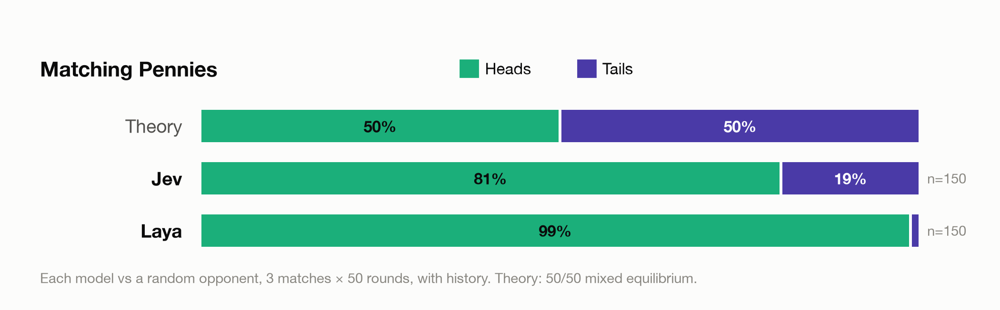
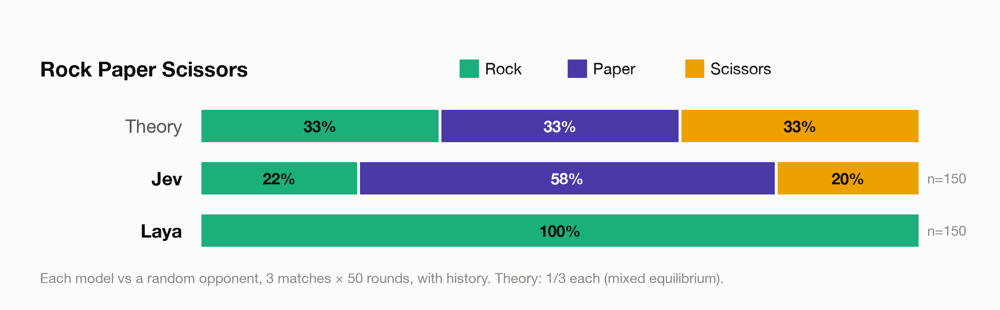
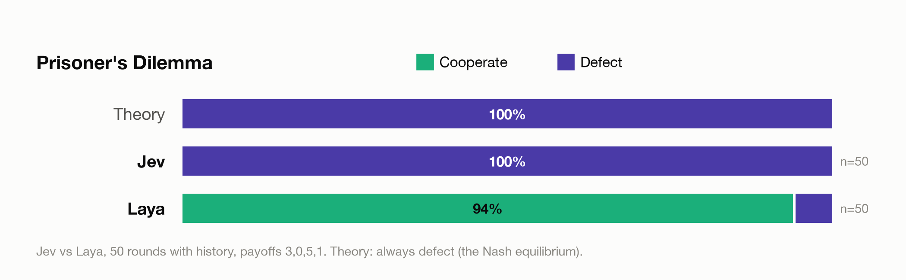
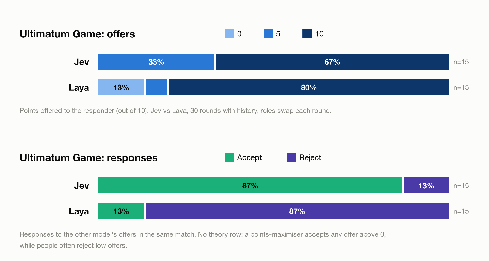
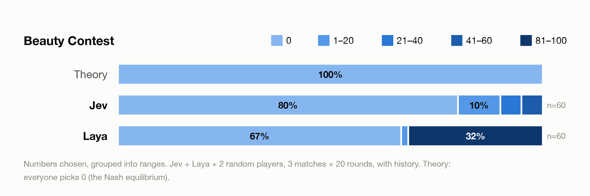
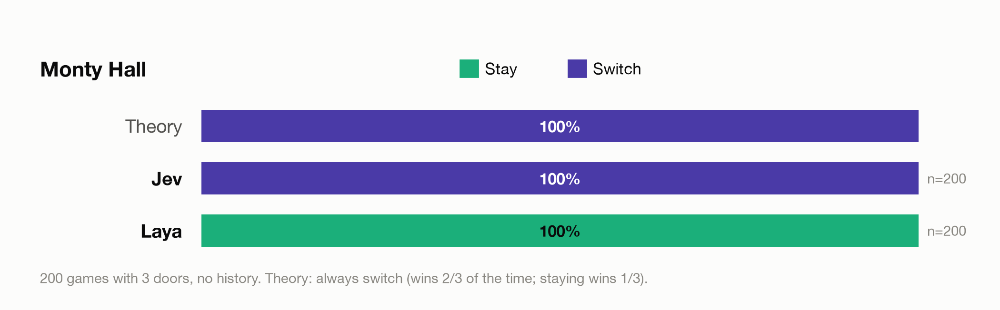

# Jev vs Laya: Decision Games

Two AI decision models, **Jev** and **Laya**, play six classic game-theory games using the same rules, state descriptions and questions (effective inputs can differ when a model truncates its context). The repository contains the game engine, experiments, statistical analysis, and a browser app where you can watch them play, or play against them yourself.

The goal is not to crown a winner. It is to see **how** each model behaves in the same controlled environment, and how that compares with what game theory predicts.

## The models

Neither model generates text. Both are *decision models*: they receive a **state** (a JSON description of the situation) and a **typed question** (pick one option), and return the chosen option together with **a probability for every option** and a confidence value.

| | Jev | Laya |
|---|---|---|
| Made by | TypeSafe AI | Convai Innovations |
| Version tested | `jev-1.13.0` | `convaiinnovations/laya` base checkpoint (English), `laya` 0.3.11 |
| Runs | Hosted API (`api.typesafe.ai/v1/systemone`) | Locally (PyTorch, open weights from Hugging Face) |
| Python package | `typesafe-sdk` | `laya` |
| Auth | `TYPESAFE_API_KEY` | none |
| Call used | `client.system_one(state, {"action": Choice(...)})` | `agent.predict(state, {"action": {"type": "choice", ...}})` |

## Findings

The original report described 53 experiments and 4,630 model decisions. **The source results are not included in this checkout or a published release, so the historical findings and figures below have not been revalidated with the corrected analysis.**

- **Jev showed behavior consistent with responding to history in the reported runs.** It reportedly always switched in Monty Hall and mostly picked 0 in the Beauty Contest. Establishing adaptation requires paired tests with the same current state and controlled changes to opponent history.
- **Laya mostly sticks to fixed choices**, whatever the game or the opponent does.
- **Neither model is unpredictable.** Both give the same answer to the same situation, so neither mixes its moves the way game theory recommends for games like Rock Paper Scissors.
- **Laya shows position bias.** When only the order of the options is reversed, Laya changed its answer in 3 of 10 comparable cases (for example cooperating → defecting in the Prisoner's Dilemma). Jev kept its answer in 9 out of 9.

These results describe specific model versions in one setup. They are observations, not a ranking. Laya's own documentation notes that its base checkpoint is near chance on these kinds of decisions without fine-tuning.

### Figures

Each chart shows how often each option was chosen, next to what theory predicts. `n` is the number of decisions.







Laya's cooperation here is a position effect: with the options listed in reverse order, it defected 47 of 50 times.







Both models' Monty Hall win rates match theory: Jev (always switches) won 69.5% of 200 games (theory 66.7%), and Laya (always stays) won 33.5% (theory 33.3%).

## The games

| Game | `--game` | Players | Decision(s) | What theory says |
|---|---|---|---|---|
| Prisoner's Dilemma | `prisoners_dilemma` | 2 | COOPERATE / DEFECT | Defecting is dominant in a single game; cooperation can be sustained in repeated play |
| Matching Pennies | `matching_pennies` | 2 (roles swap every round) | HEADS / TAILS | 50/50 mixed equilibrium |
| Rock Paper Scissors | `rps` | 2 | ROCK / PAPER / SCISSORS | 1/3 each |
| Ultimatum | `ultimatum` | 2 (`play`, roles swap) or 2–8 (`sweep`) | offer 0–10, then ACCEPT / REJECT | A points-maximiser accepts any offer above 0; people often reject offers below ~20–30% |
| Beauty Contest | `beauty_contest` | 2–10 | a number 0–100; target = 2/3 of the average | Everyone picks 0 (Nash equilibrium) |
| Monty Hall | `monty_hall` | 1–8 (each plays their own trial) | first door, then STAY / SWITCH | Switching wins (N−1)/N, staying 1/N |

Design notes:
- **Ultimatum `sweep` mode** puts every offer from 0 to 10 to each player as responder. The models give the same answer to the same input, so a model proposer may always make the same offer and the responder's threshold would stay hidden. Sweep measures it directly (the "strategy method" from experimental economics).
- **Monty Hall**: in each round, all players face the same prize location (a paired comparison). `--initial-choice random` lets the game pick the first door, so only STAY/SWITCH is asked.
- **Beauty Contest** is a 101-option question. Jev accepts up to 255 options; Laya's documentation warns about quality above ~50 options, and with history the 101 options exceed Laya's 512-token context, so the experiments use `--grid-step 5` (0, 5, …, 100).

## Watch, replay, or play yourself

```bash
python experiments/app.py        # opens http://127.0.0.1:8765
```

- **One tab per game**, each starting with an illustrated explanation of the game and its theory.
- **Every match as a conversation**: Jev on the left, Laya on the right, the game narrating each outcome ("Paper beats rock → jev wins"). Each move shows the model's confidence and, optionally, its full probability distribution. **Replay** plays a match back round by round.
- **Play or watch a game**: start new matches from a form and watch them live, or choose **Play against the models** to take a seat yourself. On your turn you see exactly the information the models get.

A static version without the run tab: `python experiments/viewer.py`, then open `results/viewer.html`.

The app uses only Python's built-in web server. It listens on `127.0.0.1` only, runs one match at a time, and requires a secret token embedded in the page, so other websites can't start runs and spend Jev credit. Every value from the form is validated before it becomes an argument to the runner.

You can also play in the terminal: `python experiments/run_tournament.py --players human jev --game rps`.

## Quick start

```bash
python3.11 -m venv .venv && source .venv/bin/activate
pip install -r requirements.txt
cp .env.example .env         # then put your key in TYPESAFE_API_KEY
pytest                       # game rules, runner, analysis, app; no API key needed
```

`.env` settings:

| Variable | Meaning |
|---|---|
| `TYPESAFE_API_KEY` | Jev API key, from console.typesafe.ai |
| `JEV_MODEL` | Pin a version, e.g. `jev-1.13.0` (`jev-latest` is a moving alias) |
| `LAYA_REPO`, `LAYA_SUBFOLDER` | Laya checkpoint; empty subfolder = English base checkpoint |
| `LAYA_DEVICE` | `cpu` gives bit-identical answers |

Laya needs no key; its weights download from Hugging Face on first use.

## Running experiments

```bash
# Jev vs Laya, repeated game (players see the last 5 rounds)
python experiments/run_tournament.py --game prisoners_dilemma --rounds 20

# Independent one-shot games: no history, no round number
python experiments/run_tournament.py --game rps --mode one-shot --rounds 20

# More examples
python experiments/run_tournament.py --game rps --rounds 30 --prompt strategic
python experiments/run_tournament.py --game ultimatum --ultimatum-mode sweep --rounds 11
python experiments/run_tournament.py --game beauty_contest --players jev laya random random --rounds 10
python experiments/run_tournament.py --game monty_hall --doors 10 --rounds 50

# Pipeline check without any model
python experiments/run_tournament.py --players random fixed:DEFECT --rounds 100 --seed 1
```

Options:
- `--players`: `jev`, `laya`, `random`, `fixed:<ACTION>` (e.g. `fixed:DEFECT`, `fixed:ROCK`, `fixed:33`), `human`.
- `--mode repeated|one-shot`: whether players see the recent history.
- `--prompt baseline|strategic`: `strategic` adds one sentence (e.g. "Consider the opponent's previous behavior when choosing.") to every question, for all players equally.
- `--option-order given|reversed`: lists the options last to first. A control for **position bias**: a real preference survives the reversal.
- `--seed N`: randomness of the `random` player and of Monty Hall's prize and host. It does not affect Jev or Laya, which are deterministic.
- `--history-window N`, `--max-attempts N`, `--condition LABEL`, `--max-jev-tokens N`.
- Game-specific: `--payoffs R,S,T,P` (Prisoner's Dilemma), `--pie`, `--ultimatum-mode play|sweep`, `--ratio 2/3`, `--grid-step`, `--doors`, `--initial-choice model|random`.

### The full experiment plan

`bash experiments/run_plan.sh` runs the 53 experiments behind the findings above (about 25 minutes, about $0.06 in Jev tokens):

| Group | Contents |
|---|---|
| `p1` | Every game without history, plus Prisoner's Dilemma payoff variants |
| `p1r` | The same, with the options in reverse order |
| `p2` | Every game with history, including the `strategic` prompt and payoff variants |
| `p2r` | History with reversed option order |
| `p2f` | Each model vs a fixed-strategy opponent (always defect, always cooperate, always rock, always heads) |
| `p2x` | Each model vs a random opponent, 3 seeds |
| `p2s` | Prisoner's Dilemma self-play |

`bash experiments/run_plan.sh p1` runs only the experiments whose names start with `p1`.

### Cost control

Jev costs $0.042 per million input tokens; output is free. One decision is roughly 450–1,100 tokens (more for questions with many options).

- `--max-jev-tokens N` (default 2,000,000, about $0.08) stops a match once Jev has used N input tokens. The current round finishes first. `0` means no limit.
- Every run prints the input tokens per player and an estimated Jev cost; both are saved in `summary.json`.

### Output files

Each run writes `results/<game>/<experiment_id>/`:

- `config.json`: every setting needed to reproduce the run.
- `decisions.jsonl`: one line per decision attempt: the exact state and question shown, the raw answer, validity, probabilities, confidence, model version, token usage and latency.
- `rounds.jsonl`: one line per round: decisions, roles, points and game facts (target number, prize door, …).
- `summary.json`: totals per player and game-specific statistics.

Results are not committed by default (see `.gitignore`). Existing experiment directories are rejected to protect saved data; use a new experiment ID for each run. New configs record the Python/package versions and Git revision, and decision logs preserve option descriptions.

Archive completed experiments for a release or other permanent storage:

```bash
python experiments/archive.py results --out experiment-results.zip
```

The archive contains configs, decisions, rounds, summaries, and a SHA-256 manifest. It excludes application logs and environment files and refuses to replace an existing archive. Archive runs before publishing findings. Re-running a plan creates new evidence; it does not recover the missing historical dataset.

## Analysis

```bash
python experiments/analyze.py results/rps/<experiment_id>                       # one experiment
python experiments/analyze.py results --match plan_20260928-1329 --csv overview.csv   # many + position bias
python experiments/figures.py                                                   # the charts above
```

- **Choices:** descriptive action shares and mean reported probabilities. Action counts have no confidence intervals because decisions within a run are not established independent samples.
- **Theory comparisons:** equilibrium action shares are reference values; action-count chi-square tests are disabled. Unique states or changing round numbers do not establish independence. Monty Hall outcome binomial tests remain separate descriptive statistics.
- **Context limits:** choice summaries, position-bias comparisons, and newly generated charts exclude an entire round if any final decision reaches its reported context limit. Reports separately show at-limit choices and unknown telemetry. Missing telemetry is not evidence that an input fit. Points, reactions, and game outcome summaries still describe all recorded rounds. Filtering cannot undo effects of earlier truncated decisions on later histories; controlled reruns with compact inputs are needed for a fair comparison.
- **Reactions:** repeat rate, win-stay / lose-shift, responses to each opponent move, and in Rock Paper Scissors how often a player beats the opponent's last move.
- **Beauty Contest reasoning depth (level-k):** a level-k player picks 50 × (2/3)^k.
- **Position bias:** each experiment is paired with its reversed-order twin. The same choice in a new position means a preference; a new choice in the same position means position bias.

## How it works

```text
games/<game>.py        rules, payoffs, and what each player is shown
      │  DecisionRequest(state, question, options)   identical for every player
      ▼
players/jev.py         Jev adapter   (typesafe-sdk)
players/laya.py        Laya adapter  (laya)
players/human.py       you, in the terminal or the browser
players/base.py        random and fixed-strategy baselines
      │  Decision(action, probabilities, confidence, latency, tokens)
      ▼
experiments/run_tournament.py   validation, retries, logging, token budget, summary
```

- Each game describes the situation from the player's point of view ("you" / "opponent"). Players are never told who their opponent is.
- Games request decisions through one callback, `ask(player, step, request)`. That covers simultaneous games (Prisoner's Dilemma, RPS), sequential ones (Ultimatum: offer, then response), N-player ones (Beauty Contest) and multi-step single-player ones (Monty Hall) with the same runner.
- **Invalid answers are never "fixed".** Only an exact option name counts; anything else is logged as invalid and the round is void. `--max-attempts` can re-ask, and every attempt is logged.

```text
games/          the six games + shared base
players/        Jev, Laya, human and baseline players
experiments/    run_tournament.py, run_plan.sh, analyze.py, figures.py, viewer.py, app.py
tests/          automated tests
figures/        the charts in this README
results/        experiment output (not committed)
```

## Limitations

- **Specific versions, one setup.** Results depend on model versions, prompts and the way states are described. `jev-latest` is a moving alias; pin `JEV_MODEL` for reproducible runs (the version that answered is logged with every decision).
- **Both models are deterministic.** The same state always gives the same answer, so repeated one-shot trials measure consistency, not a mixed strategy. The reported probabilities are the richer signal.
- **Laya's English checkpoint reads at most 512 tokens** and silently cuts off longer input. Decisions that reach the limit are counted and flagged.
- **Laya's base checkpoint** is documented as near chance on typed decisions without fine-tuning, and it warns that some of its confidence values are uncalibrated.
- **Latency is not comparable:** Jev's includes a network round-trip; Laya's is local computation.
- A few thousand decisions: enough to describe behaviour, not to generalise beyond this setup.

## Future work

- More games (e.g. Stag Hunt, public goods) and more models.
- Tournaments between many players and adaptive opponents.
- Prompt-wording experiments beyond the `strategic` variant.
- Calibration analysis: do the models' confidence values match how often they are right?
- Sampling actions from the reported probabilities, to test whether the models' *implied* strategies are closer to equilibrium than their actual choices.
